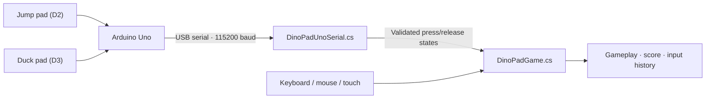

# DinoPad

**An Arduino-controlled dinosaur runner with two physical jump/duck pads, built in Unity.**

DinoPad connects a simple **Arduino Uno** controller to a **Unity 6** game. Two normally-open floor pads provide **Jump** and **Duck** inputs over USB serial, while keyboard, mouse, and touch controls let anyone try the game without custom hardware.

The project combines embedded programming, physical interface design, serial communication, and real-time game logic.


## Highlights

- **Physical two-pad input:** Jump is activated on a new press; Duck stays active while held.
- **Arduino-to-Unity serial link:** newline-terminated `S,jump,duck` messages at **115200 baud**, 25 ms switch debounce, and approximately 120 ms state heartbeats.
- **No hardware required to try it:** keyboard, mouse, and touch alternatives to the physical switches.
- **Runner gameplay:** randomly generated cactus and bird obstacles, increasing speed, collisions, restart, and a winning-score goal.
- **Saved progress:** personal-best score and adjustable winning-score target via Unity `PlayerPrefs`.
- **Input history:** the most recent configurable **N** button presses, including input source, score, and time since scene load.
- **Connection feedback:** live Arduino status, automatic reconnection, and release of pressed states on disconnect.

## Try DinoPad

The repository includes the **full Unity source project and Arduino firmware**. It does not include a pre-built executable.

### Play without an Arduino

1. Clone or download this repository.
2. In **Unity Hub**, select **Add project from disk**.
3. Choose the inner folder **`DinoPad_Unity_Project - Copy`**, which contains `Assets`, `Packages`, and `ProjectSettings`.
4. Open it in Unity **6000.6.6f1** (the recorded Editor version), or a compatible Unity 6 Editor.
5. Open **`Assets/DinoPadGame/Scenes/DinoPadGame.unity`**.
6. Select **Dino Pad Game** in the Hierarchy and disable **Connect On Start** on its **Dino Pad Uno Serial** component.
7. Press **Play**. Use **Space / W / Up arrow** for Jump and **S / Down arrow** for Duck.

The scene contains an on-screen **START** button, **JUMP** and **DUCK** controls, and a **PLAY AGAIN** option after a run.

### Play with the physical pads

You will need an Arduino Uno or compatible board, two normally-open switches or pressure pads, and a USB data cable.

```text
Jump pad: Uno D2 ──[normally-open switch]── GND
Duck pad: Uno D3 ──[normally-open switch]── GND
Arduino Uno ─────────── USB cable ───────── Computer
```

1. Wire **Jump** from D2 to GND and **Duck** from D3 to GND.
2. Open and upload [**DinoPad_Uno.ino**](DinoPad_Unity_Project%20-%20Copy/Assets/DinoPadGame/Arduino/DinoPad_Uno.ino) with Arduino IDE.
3. Optional: verify lines like `S,0,0`, `S,1,0`, and `S,0,1` in **Serial Monitor at 115200 baud**, then **close Serial Monitor**.
4. In Unity's **Player → Other Settings**, use **.NET Framework** for desktop serial support.
5. On **Dino Pad Game → Dino Pad Uno Serial**, set the Uno's **Port Name**, keep **Baud Rate = 115200**, and enable **Connect On Start**.
6. Press Play and check the on-screen **UNO USB** connection status.

The sketch configures `INPUT_PULLUP`: **LOW means pressed**, because each switch closes its Arduino input to GND. No external pull-up resistor is needed. **Do not wire a pad across 5 V and GND.**

For a complete wiring diagram and troubleshooting steps, see the [hardware setup guide](docs/HARDWARE_SETUP.md).

## Controls

| Action | Keyboard / mouse / touch | Arduino |
| --- | --- | --- |
| Start or jump | Space, W, Up arrow; on-screen JUMP or START | Jump pad on **D2** |
| Duck (hold) | S, Down arrow; on-screen DUCK | Duck pad on **D3** |
| Retry | PLAY AGAIN button or new Jump press | Jump pad |
| Adjust winning score | On-screen **− / +** controls | — |
| Clear press history | On-screen **CLEAR** | — |

Jump triggers once per press; Duck is held for as long as its switch is pressed. The game also accepts clicking/tapping in the play field to jump while running.

**Winning-score note:** The included demo scene sets the target to **2,000**. The C# component declares a fallback of **500** for newly created scenes. A previously saved goal, if any, overrides the scene setting on startup. See the [user guide](docs/USER_GUIDE.md) for details.

## How the hardware and game communicate



The Uno sends state messages such as `S,1,0` for Jump pressed and Duck released. `DinoPadUnoSerial.cs` reads packets in a background thread and applies the resulting inputs during Unity's main-thread updates. The renderer uses Unity's built-in IMGUI drawing; no external sprite assets are needed to play.

## Documentation

| Guide | Contents |
| --- | --- |
| [User guide](docs/USER_GUIDE.md) | Gameplay, controls, score settings, input history, and UI indicators |
| [Hardware setup](docs/HARDWARE_SETUP.md) | Switch wiring, firmware upload, serial testing, and troubleshooting |
| [System architecture](docs/SYSTEM_ARCHITECTURE.md) | Firmware–Unity data flow, component responsibilities, and message protocol |
| [Testing checklist](docs/TESTING.md) | Manual keyboard, Arduino, integration, and persistence test plan |
| [Building for desktop](docs/BUILDING.md) | Adding the scene to Unity build profiles and exporting a standalone app |

## Repository layout

```text
DinoPad/
├── README.md
├── docs/
│   ├── USER_GUIDE.md
│   ├── HARDWARE_SETUP.md
│   ├── SYSTEM_ARCHITECTURE.md
│   ├── TESTING.md
│   └── BUILDING.md
└── DinoPad_Unity_Project - Copy/
    ├── Assets/DinoPadGame/
    │   ├── Arduino/DinoPad_Uno.ino
    │   ├── Editor/DinoPadSceneTools.cs
    │   ├── Scenes/DinoPadGame.unity
    │   ├── Scripts/DinoPadGame.cs
    │   └── Scripts/DinoPadUnoSerial.cs
    ├── Packages/
    └── ProjectSettings/
```

**Open the inner Unity project**, not the repository root.

## Known limitations and project status

- The current repository contains **source code**, not a packaged game executable, `.unitypackage`, or controller enclosure CAD/3D-print files.
- The checked-in Unity **build scene list is empty**; add `Assets/DinoPadGame/Scenes/DinoPadGame.unity` in **Build Profiles** before exporting. Follow the [build guide](docs/BUILDING.md).
- Serial hardware input targets **desktop Unity**, not WebGL/browser builds.
- Unity Editor execution, the full physical pad assembly, and standalone builds have **not been independently verified as part of this documentation update**. Use the [manual testing checklist](docs/TESTING.md) to record successful tests.
- No open-source license file is included yet; reuse terms should be decided by the repository owner.

---

**Built with:** Arduino Uno · C# · Unity 6 · USB serial · 3D-printed/physical controller prototyping
