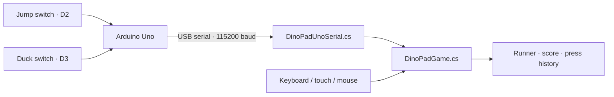

# DinoPad

**A two-pad, Arduino-controlled dinosaur runner built in Unity.**

DinoPad turns two physical foot pads into **Jump** and **Duck** controls for a side-scrolling runner. An Arduino Uno reads the pads and sends their states over USB serial to a Unity desktop game. The game also works with a keyboard, mouse, or touch input, so you can try it without the hardware.

The project combines physical interface design, microcontroller firmware, serial communication, and game development.

## Features

- **Two physical inputs:** Jump is triggered on a new press; Duck stays active while held.
- **Arduino Uno + USB serial:** compact `S,jump,duck` messages at 115200 baud, with debounce and periodic updates.
- **Playable without the controller:** keyboard (Space/W/Up to jump; S/Down to duck) and on-screen controls.
- **Runner gameplay:** cactus and bird obstacles, increasing speed, collision detection, and restart.
- **Scoring:** personal best, adjustable winning-score target (default 500), and win/game-over events.
- **Input history:** shows the last N presses, including their source, score, and elapsed time (default N = 10).
- **Connection feedback:** on-screen serial status and automatic reconnect attempts.

## Hardware and software

| Component | Purpose |
| --- | --- |
| Arduino Uno R3 (or compatible) | Reads the two switches |
| 2 normally-open switches / pressure pads | Jump and Duck inputs |
| USB data cable | Power and communication between Uno and computer |
| Unity 6 desktop Editor | Runs the game |
| Arduino IDE 2 | Uploads the Uno sketch |

The project records **Unity Editor 6000.6.6f1** in `ProjectSettings/ProjectVersion.txt`. A compatible Unity 6 Editor may prompt to upgrade the project.

### Wiring

```text
Jump pad: Arduino D2 ── normally-open switch ── GND
Duck pad: Arduino D3 ── normally-open switch ── GND
Arduino:  USB cable ───────────────────────── computer
```

The Arduino sketch enables internal pull-up resistors, so pressing each pad connects its input to ground. Do not wire the input pins directly to 5 V. For more details, see [Hardware setup](docs/HARDWARE_SETUP.md).

## Quick start

### Option A — Play without Arduino

1. Clone or download this repository.
2. Open **Unity Hub → Add project from disk**.
3. Select the inner folder **`DinoPad_Unity_Project - Copy`**, which contains `Assets`, `Packages`, and `ProjectSettings`.
4. Open it in a compatible Unity 6 Editor.
5. Open `Assets/DinoPadGame/Scenes/DinoPadGame.unity`.
6. In the Hierarchy, select **Dino Pad Game** and uncheck **Connect On Start** in the **Dino Pad Uno Serial** component if you aren't using an Uno.
7. Press **Play**. Use Space/W/Up to jump and S/Down to duck, or click the on-screen pads.

### Option B — Play with the physical pads

1. Connect the Jump switch between **D2 and GND**, and the Duck switch between **D3 and GND**.
2. In Arduino IDE 2, open [DinoPad_Uno.ino](DinoPad_Unity_Project%20-%20Copy/Assets/DinoPadGame/Arduino/DinoPad_Uno.ino), choose **Arduino Uno** and the correct serial port, and upload the sketch.
3. Optionally verify output using **Serial Monitor at 115200 baud**, then **close it** so Unity can open the same port.
4. In Unity, set **Edit → Project Settings → Player → Other Settings → API Compatibility Level** to **.NET Framework** for desktop serial support.
5. Select the **Dino Pad Game** GameObject and set its **Dino Pad Uno Serial** component:
   - **Port Name:** the Uno port, such as `COM4` on Windows or `/dev/cu.usbmodem...` on macOS. `AUTO` only works when exactly one serial port is detected.
   - **Baud Rate:** `115200`
   - **Connect On Start:** enabled
6. Press **Play**, then check the on-screen `UNO USB` status.

> The Uno is a USB **serial device**, not a keyboard emulator. Direct serial input here targets desktop Unity; browser/WebGL builds are not supported by this input path.

## Controls

| Action | Arduino pad | Keyboard |
| --- | --- | --- |
| Jump / start | Jump (D2) | Space, W, Up |
| Duck (hold) | Duck (D3) | S, Down |
| Retry after game over | On-screen Play Again | On-screen Play Again |

The on-screen Jump and Duck controls also support mouse and touch.

## How it works



The Arduino sends complete lines such as `S,1,0` (jump pressed, duck released). `DinoPadUnoSerial.cs` reads them on a worker thread and applies inputs in Unity's main update loop. Jump fires on a press transition, while Duck remains active for as long as the pad is held. The Unity game uses built-in IMGUI drawing, so no external sprites or UI packages are required to see the game.

## Repository layout

```text
DinoPad/
├── README.md
├── docs/
│   └── HARDWARE_SETUP.md
└── DinoPad_Unity_Project - Copy/
    ├── Assets/DinoPadGame/
    │   ├── Arduino/DinoPad_Uno.ino
    │   ├── Editor/DinoPadSceneTools.cs
    │   ├── Scenes/DinoPadGame.unity
    │   ├── Scripts/DinoPadGame.cs
    │   └── Scripts/DinoPadUnoSerial.cs
    ├── Packages/
    └── ProjectSettings/
```

Open the **inner Unity project folder**, not the repository root. Its existing name is preserved to avoid moving project files unnecessarily.

## Troubleshooting

- **Port access denied:** Close Arduino IDE Serial Monitor/Plotter and any other application using the port.
- **No USB connection:** Verify the USB data cable, port, 115200 baud, and Arduino sketch.
- **Multiple ports detected:** Specify the exact port in Unity rather than using `AUTO`.
- **`System.IO.Ports` compilation errors:** Use the desktop build target and `.NET Framework` API compatibility.
- **Board connects but pad doesn't respond:** Briefly connect D2 or D3 to GND to isolate wiring problems.
- **Want to play without hardware:** Disable **Connect On Start** and use the keyboard.

## Project status

This repository provides **Unity source code and Arduino firmware**, not a packaged executable, `.unitypackage`, or 3D-printable controller enclosure. Full Unity Editor execution and physical hardware testing have **not** been verified as part of this documentation update.

*A game screenshot and a photo of the physical pads would make a great addition to this README when available.*