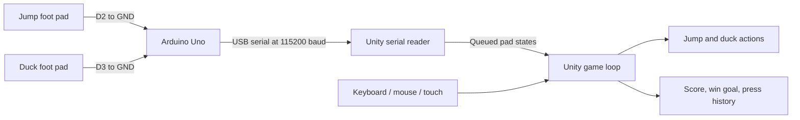

# DinoPad technical design

DinoPad is a two-input physical controller and Unity dinosaur-runner project. The Arduino handles switch sensing and debouncing; Unity handles serial input, gameplay state, collision detection, the interface, and scoring.

## System overview



## Hardware interface

The supplied Arduino sketch uses **internal pull-up resistors**. Each normally-open switch reads HIGH when released and LOW when pressed. The firmware debounces state changes for approximately **25 ms**, then sends state packets when anything changes. It also transmits a heartbeat about every **120 ms** so the Unity side can detect a lost or reconnected board.

| Arduino input | Function | Electrical connection |
| --- | --- | --- |
| D2 | Jump | Normally-open switch to GND |
| D3 | Duck | Normally-open switch to GND |

Detailed wiring and testing instructions are in [HARDWARE_SETUP.md](HARDWARE_SETUP.md).

## Serial protocol

Each message is one newline-terminated ASCII line:

```text
S,<jump>,<duck>
```

Each field is **1 when pressed** and **0 when released**, e.g. `S,1,0` for Jump pressed and Duck released. Unity and the Uno use **115200 baud**. This protocol deliberately has only two inputs and does not depend on any third-party Arduino libraries.

## Software responsibilities

**Arduino firmware — `DinoPad_Uno.ino`**

- Reads two switches, debounces them, sends current state and heartbeats.
- Implements the device side of the serial protocol.

**Unity serial adapter — `DinoPadUnoSerial.cs`**

- Opens the selected USB serial port (or tries `AUTO` when one port is detected).
- Reads lines on a background thread and queues validated pad states.
- Applies queued input on Unity's main thread.
- Triggers Jump only on a new press and tracks held Duck state.
- Releases inputs on disconnection and retries the serial connection.

**Game and interface — `DinoPadGame.cs`**

- Runs a two-input side-scrolling obstacle game with gradually increasing speed.
- Tracks the current score and a persistent personal best.
- Stores an adjustable winning-score goal in `PlayerPrefs`.
- Records the latest configurable number of button presses, including input source, score, and elapsed time.
- Supports keyboard, touch, and mouse input for testing without hardware.
- Draws the game's visuals in Unity without requiring external sprite artwork.

## Why this split matters

Keeping low-level switch handling in the Arduino and gameplay on the Unity side makes the hardware easier to test independently. You can validate the Arduino in Serial Monitor before connecting Unity, or test the full game using keyboard-only controls.

## Current scope

The repository includes the Unity source project and Arduino firmware. Physical controller enclosure/3D-print files, release builds, and verified end-to-end hardware test footage are not included.

Start with the [main project README](../README.md) to open the project and run the game.
